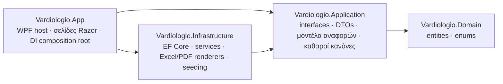

# Βαρδιολόγιο — Shift Roster

[English](README.md) · **Ελληνικά**


-5C2D91)


Το Βαρδιολόγιο είναι εφαρμογή για υπολογιστές Windows. Οργανώνει το μηνιαίο πρόγραμμα βαρδιών
μιας δημόσιας υπηρεσίας που λειτουργεί όλο το εικοσιτετράωρο και παράγει όλα τα επίσημα
έντυπα που υποβάλλει η υπηρεσία για τη μισθοδοσία: μηνιαίους πίνακες, πίνακες παρουσιών,
πιστοποιήσεις υπερωριών και αναφορές ωρών, σε Excel και PDF.

Αντικατέστησε μια σειρά από βιβλία Excel που συντηρούνταν με το χέρι. Οι ώρες υπολογίζονται
πλέον από κανόνες αντί για τύπους, τα επίσημα έντυπα βγαίνουν έτοιμα για υπογραφή, και η
μηνιαία προετοιμασία της μισθοδοσίας μειώθηκε από περίπου τέσσερις ημέρες δουλειάς σε Excel
σε μία ημέρα.

**Κατάσταση: ολοκληρωμένη.** Η εφαρμογή χρησιμοποιείται καθημερινά. Συντηρείται με διορθώσεις
και μικρές αλλαγές που ζητούν οι χρήστες της.

---

## Περιεχόμενα

- [Κύρια σημεία](#κύρια-σημεία)
- [Λειτουργίες](#λειτουργίες)
- [Τεχνολογίες](#τεχνολογίες)
- [Αρχιτεκτονική](#αρχιτεκτονική)
- [Σχεδιαστικές επιλογές](#σχεδιαστικές-επιλογές)
- [Δομή του κώδικα](#δομή-του-κώδικα)
- [Εκκίνηση](#εκκίνηση)
- [Ιδιωτικά δεδομένα και ρυθμίσεις](#ιδιωτικά-δεδομένα-και-ρυθμίσεις)
- [Αρχεία στον δίσκο](#αρχεία-στον-δίσκο)
- [Εκδόσεις](#εκδόσεις)
- [Άδεια χρήσης](#άδεια-χρήσης)

---

## Κύρια σημεία

- **Εφαρμογή υπολογιστή με web διεπαφή.** Τα components του Blazor φιλοξενούνται σε WPF μέσω
  BlazorWebView (WebView2). Ο χρήστης έχει ένα κανονικό πρόγραμμα Windows που εγκαθίσταται
  ανά χρήστη, ενώ η διεπαφή χτίζεται με Razor και MudBlazor.
- **Ώρες από κανόνες, όχι από τύπους.** Κάθε κωδικός βάρδιας ορίζει πόσες ώρες δίνει σε κάθε
  κατηγορία πληρωμής, ανά είδος ημέρας (καθημερινή, Σάββατο, Κυριακή, αργία). Ένας υπολογιστής
  εφαρμόζει τα μηνιαία όρια και δίνει δηλωμένες, πληρωτέες και πλεονάζουσες ώρες. Όλες οι
  αναφορές διαβάζουν τους ίδιους αριθμούς.
- **Επτά επίσημα έντυπα.** Το καθένα αναπαράγει το χάρτινο ή Excel πρωτότυπο της υπηρεσίας,
  με εθνόσημο, στοιχεία υπηρεσίας, κείμενα και χρώματα που αλλάζουν, και υπογραφές.
  Εξάγονται σε Excel (ClosedXML) και PDF (QuestPDF), με προεπισκόπηση στην οθόνη.
- **Κανόνες εκτύπωσης που ισχύουν στο χαρτί.** Κάθε σελίδα αριθμείται «Σελίδα X από Y», και οι
  υπογραφές δεν τυπώνονται ποτέ σε σελίδα χωρίς εργαζόμενους: η τελευταία γραμμή μεταφέρεται
  μαζί τους.
- **Ασφαλείς αναβαθμίσεις.** Κάθε αλλαγή είναι προσθετικό migration του EF Core. Τα δεδομένα
  των χρηστών διατηρούνται σε κάθε νέο πρόγραμμα εγκατάστασης, και αντίγραφα της βάσης
  εξάγονται και εισάγονται.
- **Ιστορικό ενεργειών.** Κάθε αποθήκευση καταγράφεται αυτόματα, μέχρι και το κάθε πεδίο που
  άλλαξε, με τον χρήστη και την ώρα.
- **Τα ιδιωτικά δεδομένα μένουν εκτός αποθετηρίου.** Ονόματα, κείμενα της υπηρεσίας, το
  εθνόσημο και τα μυστικά κλειδιά εξαιρούνται από το git. Για το καθένα υπάρχει δοκιμαστικό
  αρχείο, ώστε ένας νέος κλώνος να χτίζεται και να τρέχει.

## Λειτουργίες

### Πρόγραμμα και εργαζόμενοι

- **Ημερήσια καταχώριση βαρδιών.** Επιλέγεται εργαζόμενος και μήνας. Τα δύο δεκαπενθήμερα
  είναι καρτέλες: κλικ σε μια ημέρα και μετά στον κωδικό της, στο πλαίσιο κωδικών δίπλα. Οι
  κωδικοί που δεν επιτρέπονται στην επιλεγμένη ημέρα πλαισιώνονται με κόκκινο. Οι ώρες του
  μήνα ανά κατηγορία πληρωμής φαίνονται ζωντανά σε σχέση με τα όριά τους.
- **Εργαζόμενοι.** Προσθήκη, αλλαγή, απενεργοποίηση και επαναφορά εργαζομένων, ανά ειδικότητα,
  με σύμβαση, θέση εργασίας, τοποθέτηση και προϊστάμενο. Ένα πεδίο αναζήτησης (επώνυμο ή/και
  όνομα, με οποιαδήποτε σειρά, χωρίς διάκριση πεζών-κεφαλαίων και τόνων) βρίσκει εργαζόμενο
  σε κάθε σελίδα που χρειάζεται.
- **Κωδικοί βαρδιών.** Κωδικοί, ωράρια, επιτρεπόμενες ημέρες και ο επιμερισμός των ωρών ανά
  κατηγορία πληρωμής αλλάζουν από σελίδα ρυθμίσεων. Ένας κωδικός δεν διαγράφεται ποτέ, μόνο
  καταργείται, ώστε οι παλιές καταχωρίσεις να κρατούν τη σημασία τους. Η αλλαγή κωδικού που
  έχει ήδη χρησιμοποιηθεί ζητά επιβεβαίωση. Η σειρά της λίστας αλλάζει με σύρσιμο (drag and drop)·
  το πλαίσιο κωδικών της εισαγωγής προγραμμάτων ακολουθεί την ίδια σειρά και αλλάζει κι αυτό
  (παρατεταμένο πάτημα σε ένα κουτάκι και σύρσιμο). Η σειρά είναι μόνο για την εμφάνιση και
  κρατιέται στον υπολογιστή.
- **Αργίες και όρια.** Αργίες ανά έτος, με πρόταση των κινητών αργιών που υπολογίζονται από
  το Ορθόδοξο Πάσχα. Τα μηνιαία όρια ανά κατηγορία πληρωμής, και ένα συνδυαστικό όριο, αλλάζουν.

### Επίσημες αναφορές και έντυπα

| Έντυπο | Περιεχόμενο | Χαρτί |
|---|---|---|
| Συνολική μηνιαία Σ.Ω. | Μία γραμμή ανά εργαζόμενο, ο κωδικός κάθε ημέρας, μία στήλη μέτρησης ανά ωράριο (όπως ορίζονται στις παραμέτρους βαρδιών), πληρωτέες ώρες «προς συμπλήρωση» και αργίας. Τρεις ομάδες: Μόνιμοι, ΙΔΑΧ, ΙΔΟΧ. | A4 οριζόντια, συνεχόμενες σελίδες |
| Πίνακας βαρδιών εργασίας | Το ίδιο πρόγραμμα στη μορφή ενός φύλλου της υπηρεσίας, με σκίαση σε Σαββατοκύριακα και αργίες, μία στήλη ανά ωράριο και τις ίδιες τρεις ομάδες με τη Σ.Ω. | A3 οριζόντια, μία σελίδα |
| Πίνακας παρουσιών προσωπικού | Ένα σημάδι ανά εργαζόμενο ανά ημέρα, ανά δεκαπενθήμερο. Τρία έντυπα: Μόνιμοι και ΙΔΑΧ, ΙΔΟΧ, Διευθυντής. | A4 οριζόντια |
| Ατομική βεβαίωση υπερωριών | Ένας εργαζόμενος, ένας μήνας: δήλωση, πληρωτέες ώρες σε έξι στήλες, υπογραφή. | A4 οριζόντια |
| Πιστοποίηση ανά σύμβαση (ΙΔΟΧ / ΙΔΑΧ / Μόνιμοι) | Οι έξι στήλες ωρών για όλους τους εργαζόμενους, ανά σύμβαση κάτω από χρωματιστές ζώνες. Δύο έντυπα: Μόνιμοι και ΙΔΑΧ ο ένας κάτω από τον άλλο, και ΙΔΟΧ· η αρίθμηση συνεχίζει σε κάθε έντυπο. | A4 οριζόντια, συνεχόμενες σελίδες |
| Μηνιαία αναφορά ωρών | Δηλωμένες, πληρωτέες και πλεονάζουσες ώρες ανά κατηγορία πληρωμής για κάθε εργαζόμενο. | A4 οριζόντια |
| Ατομική μηνιαία | Ανάλυση ενός εργαζομένου ημέρα προς ημέρα: ωράρια βάρδιας και υπερωρίας, ώρες, παρουσίες, συγκεντρωτικοί πίνακες, δύο υπογραφές. | A4 οριζόντια, μία σελίδα |

Κοινά σε όλα τα έντυπα:

- **Προεπισκόπηση, Excel και PDF.** Η προεπισκόπηση είναι το ίδιο το PDF, άρα η οθόνη δείχνει
  ακριβώς ό,τι θα τυπωθεί. Οι αναφορές που δεν χρειάζονται επιλογή εργαζομένου ανοίγουν με
  τον τρέχοντα μήνα ήδη στην οθόνη.
- **Κείμενα και χρώματα που αλλάζουν.** Τα στοιχεία υπηρεσίας, οι τίτλοι, οι αποφάσεις, ο
  αποδέκτης και οι υπογράφοντες κάθε εντύπου, και τα χρώματα των αναφορών, αποθηκεύονται στη
  βάση. Αλλάζουν από σελίδα ρυθμίσεων, με αναίρεση της τελευταίας αποθήκευσης. Οι ημερομηνίες
  και οι περίοδοι συμπληρώνονται πάντα αυτόματα.
- **Κανόνες σελίδας.** Αρίθμηση σε κάθε σελίδα. Οι υπογραφές και το υπόμνημα μοιράζονται πάντα
  τη σελίδα τους με τον τελευταίο εργαζόμενο: ακριβώς στο PDF, κατ' εκτίμηση στο Excel, όπου ο
  χρήστης μπορεί ακόμη να μετακινήσει την αλλαγή σελίδας.
- **Οργανωμένα αρχεία.** Τα αρχεία αποθηκεύονται στο `Έγγραφα\Vardiologio\Reports\<αναφορά>\<yyyy-MM Month>`
  και ανοίγουν αμέσως.

### Διαχείριση και ασφάλεια

- **Χρήστες.** Κάθε εγκατάσταση έχει τους δικούς της χρήστες. Δημιουργούνται από την οθόνη
  σύνδεσης και αποθηκεύονται με hash PBKDF2-SHA256 και salt. Ένας λογαριασμός διαχειριστή
  έρχεται με το πρόγραμμα εγκατάστασης.
- **Περιοχή διαχειριστή.** Περιλαμβάνει:
  - το ιστορικό ενεργειών, με μία καρτέλα ανά περίοδο δεδομένων, φίλτρα χρήστη και ημερομηνίας,
    και τις αλλαγές κάθε πεδίου·
  - το αρχείο σφαλμάτων·
  - τη διαχείριση χρηστών, με όριο στο πλήθος τους·
  - ένα zip όλου του φακέλου εγγράφων.
- **Ιστορικό ενεργειών.** Ένας `SaveChangesInterceptor` του EF Core καταγράφει κάθε αποθήκευση,
  σε κάθε πίνακα, στην ίδια συναλλαγή με τα δεδομένα. Καταγράφονται επίσης οι εξαγωγές αναφορών,
  οι μεταφορές της βάσης και τα αρχεία zip.
- **Εξαγωγή και εισαγωγή βάσης.**
  - Η εξαγωγή γράφει ένα χρονολογημένο αντίγραφο της βάσης στον φάκελο εγγράφων.
  - Η εισαγωγή δέχεται μόνο βάση με το ίδιο σχήμα. Πρώτα κρατά αντίγραφο των τρεχόντων
    δεδομένων, διατηρεί τους χρήστες της εγκατάστασης και αποσυνδέει όλους.
- **Αρχείο σφαλμάτων.** Τα σφάλματα εκκίνησης, οι μη αναμενόμενες εξαιρέσεις, οι αποτυχημένες
  αποθηκεύσεις και οι αποτυχημένες εξαγωγές γράφονται σε ημερήσια αρχεία.

### Υποστήριξη μέσα στην εφαρμογή

- **Βοήθεια ανά σελίδα.** Ένα πλαϊνό συρτάρι περιέχει τις οδηγίες της τρέχουσας σελίδας, σε
  τυπικά ελληνικά. Μένει ανοιχτό δίπλα στη σελίδα και ακολουθεί τον χρήστη από σελίδα σε σελίδα.
- **Μήνυμα στον προγραμματιστή.** Μια φόρμα στο ίδιο συρτάρι ζητά:
  - το είδος (σφάλμα ή προσθήκη) και το μενού που αφορά·
  - όνομα, e-mail και κείμενο.

  Η εφαρμογή στέλνει το μήνυμα μέσω HTTPS στο Telegram bot του προγραμματιστή, ως zip μαζί με
  τα αρχεία σφαλμάτων των τελευταίων ημερών. Όταν δεν μπορεί να σταλεί, το zip κρατιέται για
  αποστολή με το χέρι.

## Τεχνολογίες

| Τομέας | Τεχνολογία |
|---|---|
| Γλώσσα και runtime | C# σε .NET 10 |
| Φιλοξενία εφαρμογής | WPF με BlazorWebView (WebView2) |
| Διεπαφή | Blazor (Razor components), MudBlazor 9 (Material Design), δικό της θέμα, ενσωματωμένη γραμματοσειρά Manrope (λειτουργεί χωρίς internet) |
| Δεδομένα | SQLite με Entity Framework Core 10: code-first, migrations, seeding, global query filters, interceptors |
| Excel | ClosedXML |
| PDF | QuestPDF |
| Σύνθεση | Microsoft.Extensions.DependencyInjection |
| Ασφάλεια | Hashing κωδικών με PBKDF2-SHA256 (`Rfc2898DeriveBytes`) |
| Διασύνδεση | Telegram Bot API μέσω `HttpClient` |
| Εγκατάσταση | Inno Setup: αυτόνομο win-x64 publish, εγκατάσταση ανά χρήστη |

## Αρχιτεκτονική

Τέσσερα projects σε πολυεπίπεδη (clean) αρχιτεκτονική. Οι εξαρτήσεις δείχνουν προς τα μέσα:



- **Domain:** χωρίς εξαρτήσεις. Περιέχει τις οντότητες (εργαζόμενοι, κωδικοί βαρδιών, ημέρες
  προγράμματος, κανόνες ωρών, χρήστες, κείμενα και χρώματα αναφορών, ιστορικό ενεργειών) και
  τα enums τους.
- **Application:** το συμβόλαιο κάθε λειτουργίας (interfaces και DTOs, ένας φάκελος ανά
  λειτουργία) και η καθαρή λογική που δεν χρειάζεται βάση. Εδώ βρίσκονται ο υπολογιστής μηνιαίων
  ωρών, οι κανόνες συμβάσεων, η αναζήτηση εργαζομένων και η διάταξη της ατομικής μηνιαίας. Η λογική
  αυτή ελέγχεται με unit tests ανεξάρτητα.
- **Infrastructure:** υλοποιεί τα συμβόλαια. Περιέχει τα services του EF Core, τους renderers
  Excel και PDF, την αποθήκευση αρχείων, τον interceptor του ιστορικού, το seeding και την
  αποστολή στο Telegram.
- **App:** ο host WPF και η διεπαφή Blazor. Το `App.xaml.cs` είναι το μόνο σημείο όπου
  συντίθεται ο γράφος των αντικειμένων.

## Σχεδιαστικές επιλογές

- **Ένα `DbContext` ανά λειτουργία.** Τα services παίρνουν `IDbContextFactory<AppDbContext>` και
  ανοίγουν context σε κάθε μέθοδο με `await using`. Αυτό ταιριάζει σε διεπαφή υπολογιστή που
  μένει ανοιχτή για ώρες.
- **Soft delete.** Εργαζόμενοι, κωδικοί βαρδιών και οι λίστες παραμέτρων έχουν `IsActive` με global
  query filter. Γραμμή στην οποία αναφέρονται άλλες γραμμές δεν διαγράφεται ποτέ φυσικά.
- **Οι κανόνες είναι δεδομένα.** Ο επιμερισμός των ωρών κάθε κωδικού ανά είδος ημέρας και
  κατηγορία πληρωμής είναι πίνακας που επεξεργάζονται οι χρήστες, όχι κώδικας. Ο υπολογιστής
  απλώς τον εφαρμόζει μαζί με τα μηνιαία όρια.
- **Χωρίς exceptions για αναμενόμενες περιπτώσεις.** Ο έλεγχος γίνεται πριν από την ενέργεια
  (για παράδειγμα, ελέγχεται ότι ένας κωδικός είναι ελεύθερος πριν δημιουργηθεί). Τα exceptions
  μένουν για τις πραγματικές αποτυχίες.
- **Οι αναβαθμίσεις δεν μηδενίζουν δεδομένα.** Οι αλλαγές σχήματος είναι προσθετικά migrations.
  Το seeding εισάγει μόνο ό,τι λείπει, γραμμή προς γραμμή, ώστε οι αλλαγές των χρηστών να μην
  αντικαθίστανται ποτέ.
- **Ένα μοντέλο ανά έντυπο.** Τα services χτίζουν ένα απλό μοντέλο, και οι renderers Excel και
  PDF σχεδιάζουν το ίδιο μοντέλο. Κοινές βοηθητικές κλάσεις κειμένων εξασφαλίζουν την ίδια
  διατύπωση και στις δύο εξόδους.
- **Ακριβής σελιδοποίηση στο PDF.** Η τελευταία γραμμή και οι υπογραφές σχεδιάζονται ως ένα
  αδιάσπαστο σύνολο, ώστε οι υπογραφές να μη μένουν ποτέ μόνες σε σελίδα.

## Δομή του κώδικα

```
Vardiologio.slnx
├── Vardiologio.Domain/            οντότητες και enums
├── Vardiologio.Application/       ένας φάκελος ανά λειτουργία: Employees, ShiftEntry, Hours, Reports,
│                                  ShiftCodes, ReportTexts, ReportColors, Auth, Activity,
│                                  DatabaseTransfer, Feedback, Files …
├── Vardiologio.Infrastructure/    οι ίδιοι φάκελοι, και επιπλέον Persistence (DbContext,
│                                  migrations, seeding) και Reports (services και renderers)
├── Vardiologio.App/               WPF host, Components (Layout, Pages, Shared), Theme, wwwroot
├── installer/Vardiologio.iss      script του Inno Setup
└── tools/New-AdminFile.ps1        δημιουργεί το αρχείο λογαριασμού του διαχειριστή
```

## Εκκίνηση

Απαιτήσεις: Windows 10 ή 11 και .NET 10 SDK. Το WebView2 runtime υπάρχει ήδη στις τρέχουσες
εκδόσεις των Windows.

```bash
git clone https://github.com/XaplanterisNikos/shift-roster.git
cd shift-roster
dotnet run --project Vardiologio.App
```

Στην πρώτη εκκίνηση η βάση δημιουργείται και γεμίζει από τα δοκιμαστικά αρχεία. Δημιουργήστε
χρήστη από την οθόνη σύνδεσης ή συνδεθείτε ως διαχειριστής με τον δημόσιο δοκιμαστικό κωδικό
`admin-demo`. Ο κωδικός αυτός ισχύει μόνο για builds από αυτό το αποθετήριο (βλ. την επόμενη
ενότητα).

**Δημιουργία προγράμματος εγκατάστασης:**

```bash
dotnet publish Vardiologio.App -c Release -r win-x64 --self-contained -o publish/Vardiologio
```

Στη συνέχεια γίνεται compile το `installer/Vardiologio.iss` με Inno Setup 6.1 ή νεότερο. Η
εγκατάσταση γίνεται ανά χρήστη, χωρίς δικαιώματα διαχειριστή, και δεν αγγίζει ποτέ τη βάση,
οπότε οι αναβαθμίσεις κρατούν τα δεδομένα.

## Ιδιωτικά δεδομένα και ρυθμίσεις

Τα προσωπικά δεδομένα και τα δεδομένα της υπηρεσίας δεν μπαίνουν ποτέ στο αποθετήριο. Κάθε
πραγματικό αρχείο εξαιρείται από το git και αντιγράφεται στο build μόνο όπου υπάρχει. Ένα
δοκιμαστικό αρχείο στη θέση του κρατά έναν νέο κλώνο λειτουργικό.

| Πραγματικό αρχείο (εκτός git) | Δοκιμαστικό αρχείο | Περιεχόμενο |
|---|---|---|
| `employees.json` | `employees.demo.json` (φανταστικά ονόματα) | Εργαζόμενοι και ειδικότητες για την πρώτη εκκίνηση |
| `report-data.json` | `report-data.demo.json` (όλες οι γραμμές κενές) | Κείμενα των επίσημων εντύπων· προαιρετικά το επώνυμο που δείχνει τον Διευθυντή |
| `emblem.png` | κανένα (τα έντυπα τυπώνονται χωρίς αυτό) | Το εθνόσημο πάνω από τα στοιχεία υπηρεσίας |
| `admin.json` | `admin.demo.json` (δημόσιος δοκιμαστικός κωδικός) | Salt και hash του κωδικού του διαχειριστή, από το `tools/New-AdminFile.ps1` |
| `telegram.json` | κανένα (τα μηνύματα κρατιούνται ως zip) | Token του bot και chat id για το μήνυμα στον προγραμματιστή |

## Αρχεία στον δίσκο

- **Βάση δεδομένων:** `%LOCALAPPDATA%\Vardiologio\vardiologio.db`. Είναι κρυφή και διατηρείται
  σε κάθε επανεγκατάσταση. Το `shift-code-order.json` δίπλα της κρατά τη σειρά των κωδικών βαρδιών (λίστα και πλαίσιο κωδικών). Ο φάκελος `Backups` δίπλα της κρατά ένα αντίγραφο σε κάθε εξαγωγή
  και πριν από κάθε εισαγωγή, έως τα 20 πιο πρόσφατα.
- **Έγγραφα\Vardiologio** (μόνο λατινικά ονόματα):
  - `Reports\<αναφορά>\yyyy-MM Month\`: τα εξαγόμενα έντυπα.
  - `Database\`: τα εξαγόμενα αντίγραφα της βάσης.
  - `Logs\yyyy-MM-dd.log`: μόνο τα σφάλματα.
  - `Feedback\`: μηνύματα προς τον προγραμματιστή που δεν στάλθηκαν.

## Εκδόσεις

Ο αριθμός έκδοσης ορίζεται σε ένα μόνο σημείο: `<Version>` στο `Vardiologio.App.csproj`. Τον
δείχνουν η οθόνη σύνδεσης, η κάρτα «σχετικά» και ο τίτλος του παραθύρου, και το πρόγραμμα
εγκατάστασης τον διαβάζει από το εκτελέσιμο. Κάθε έκδοση είναι ένα Git tag με πρόγραμμα
εγκατάστασης, δημοσιευμένο στα GitHub Releases.

## Άδεια χρήσης

MIT. Βλ. [LICENCE](LICENCE).
