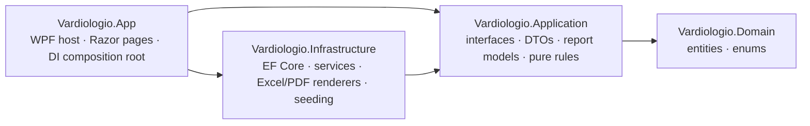

# Vardiologio — Shift Roster

**English** · [Ελληνικά](README.el.md)


-5C2D91)


Vardiologio (Greek for *shift log*) is a Windows desktop application that runs the monthly
shift roster of a public-sector department working around the clock, and produces every
official form the department submits for payroll: monthly rosters, attendance sheets,
overtime certificates and hours reports, in Excel and PDF.

It replaced a set of hand-maintained Excel workbooks. Hours are now calculated from rules
instead of formulas, the official forms come out ready to sign, and the monthly payroll
preparation went from about four days of spreadsheet work to a single day.

**Status: complete.** The application is in daily use. It is maintained with fixes and small
changes requested by its users.

---

## Contents

- [Highlights](#highlights)
- [Features](#features)
- [Technology](#technology)
- [Architecture](#architecture)
- [Design decisions](#design-decisions)
- [Project structure](#project-structure)
- [Getting started](#getting-started)
- [Private data and configuration](#private-data-and-configuration)
- [Files on disk](#files-on-disk)
- [Versioning and releases](#versioning-and-releases)
- [Licence](#licence)

---

## Highlights

- **Desktop application with a web UI.** Blazor components hosted in WPF through
  BlazorWebView (WebView2): the users get a native Windows program that installs per user,
  while the interface is built with Razor and MudBlazor.
- **Hours as rules, not formulas.** Every shift code says how many hours it gives in each pay
  category on each kind of day (weekday, Saturday, Sunday, holiday). A calculator applies the
  monthly limits and reports declared, paid and excess hours. Every report reads the same numbers.
- **Seven official forms.** Each one is reproduced from the organisation's paper or Excel
  original, with emblem, letterhead, editable texts, colours and signatures. They export to
  Excel (ClosedXML) and PDF (QuestPDF), with an inline preview.
- **Print rules that hold on paper.** Every page is numbered "Σελίδα X από Y", and the
  signatures never print on a page without employees: the last row moves with them.
- **Safe upgrades.** Every change is an additive EF Core migration. The users' data survives
  every new installer, and copies of the database can be exported and imported.
- **Audit trail.** Every save is recorded automatically, down to each changed field, with its
  user and time.
- **Private data stays out of the repository.** Names, organisation texts, the emblem and
  secrets are git-ignored. Each has a committed demo file, so a fresh clone builds and runs.

## Features

### Roster and employees

- **Daily shift entry.** Pick an employee and a month. The two fortnights are tabs: click a
  day, then its code in the panel of codes next to it. Codes not allowed on the picked day are
  framed in red. The month's hours per pay category are shown live against their limits.
- **Employees.** Create, edit, deactivate and restore employees, organised by speciality, with
  contract, work position, placement and supervisor. A search box (surname and/or first name,
  any order, case- and accent-insensitive) finds an employee on every page that needs one.
- **Shift codes.** Codes, times, allowed days and the hour split per pay category are edited
  on a settings page. A code is never deleted, only retired, so old roster entries keep their
  meaning. Changing a code that is already used asks for confirmation. The list can be
  rearranged by drag and drop; the box of codes on the shift entry screen follows the same order
  and can be rearranged too (hold a tile, then drag it). That order is display only and is kept
  on the computer.
- **Holidays and limits.** Holidays per year, with a suggestion of the movable ones calculated
  from Orthodox Easter. The monthly limits per pay category, and a combined limit, are editable.

### Official reports and forms

| Form | Content | Paper |
|---|---|---|
| Monthly roster (Συνολική μηνιαία Σ.Ω.) | One row per employee, the code of every day, a count column per work code (following the shift parameters), paid "to complete" and holiday hours. Three groups: permanent, open-ended, fixed-term. | A4 landscape, page flow |
| Official shift table (Πίνακας βαρδιών εργασίας) | The same roster in the organisation's single-sheet layout, with weekends and holidays shaded, a count column per work code and the same three groups as the monthly roster. | A3 landscape, one page |
| Staff attendance (Πίνακας παρουσιών) | One mark per employee per day, per fortnight. Three forms: permanent and open-ended staff, fixed-term staff, head of the directorate. | A4 landscape |
| Individual overtime certificate | One employee, one month: declaration, paid hours in six columns, signature. | A4 landscape |
| Overtime certificate per contract | The six hour columns for every employee, grouped by contract under coloured bands. Two forms: permanent and open-ended staff one under the other, and fixed-term staff; the running number goes through each form. | A4 landscape, page flow |
| Monthly hours report | Declared, paid and excess hours per pay category for every employee. | A4 landscape |
| Individual monthly sheet | Day-by-day analysis of one employee: shift and overtime times, hours, attendance, summary blocks, two signatures. | A4 landscape, one page |

Common to every form:

- **Preview, Excel and PDF.** The preview is the PDF itself, so the screen shows exactly what
  gets printed. Reports that need no employee open with the current month already shown.
- **Editable texts and colours.** The letterhead, titles, decisions, addressee and signatories
  of every form, and the fill colours of the reports, are stored in the database and edited on a
  settings page, with undo of the last save. Dates and periods are always filled in automatically.
- **Page rules.** Page numbers on every page. The closing block (signatures, legend) always
  shares its page with the last employee: exact in the PDF, estimated in Excel, where the user
  can still move the page break.
- **Organised output.** Files are saved under `Documents\Vardiologio\Reports\<report>\<yyyy-MM Month>`
  and opened at once.

### Administration and safety

- **Users.** Each installation has its own users, created from the login screen and stored
  with salted PBKDF2-SHA256 hashes. One administrator account comes with the installer.
- **Administrator's area.** It holds the activity log (one tab per epoch of the data, filters
  by user and date, field-level changes), the error log, user management with a limit on the
  number of users, and a zip of the whole documents folder.
- **Activity log.** An EF Core `SaveChangesInterceptor` records every save, for every table,
  in the same transaction as the data. Report exports, database transfers and archives are
  recorded too.
- **Database export and import.** A dated copy of the database goes to the documents folder.
  An import accepts only a database of the same schema. It backs up the current data first,
  keeps the installation's users and signs everybody out.
- **Error log.** Startup errors, unhandled exceptions, failed saves and failed exports are
  written to daily log files.

### Support inside the application

- **Context help.** A side drawer holds the instructions of the current page, in formal Greek.
  It stays open next to the page and follows the user from page to page.
- **Message to the developer.** A form in the same drawer: kind (error or addition), the menu
  concerned, name, e-mail address and text. The application sends it over HTTPS to the
  developer's Telegram bot as a zip with the last days' error logs. When it cannot be sent, the
  zip is kept for sending by hand.

## Technology

| Area | Technology |
|---|---|
| Language and runtime | C# on .NET 10 |
| Desktop host | WPF with BlazorWebView (WebView2) |
| User interface | Blazor (Razor components), MudBlazor 9 (Material Design), custom theme, bundled Manrope font (works offline) |
| Data | SQLite with Entity Framework Core 10: code-first, migrations, seeding, global query filters, interceptors |
| Excel output | ClosedXML |
| PDF output | QuestPDF |
| Composition | Microsoft.Extensions.DependencyInjection |
| Security | PBKDF2-SHA256 password hashing (`Rfc2898DeriveBytes`) |
| Integration | Telegram Bot API over `HttpClient` |
| Installer | Inno Setup: self-contained win-x64 publish, per-user installation |

## Architecture

Four projects in a layered (clean) architecture. Dependencies point inward:



- **Domain** has no dependencies: the entities (employees, shift codes, roster days, hour
  rules, users, report texts and colours, activity log) and their enums.
- **Application** holds the contract of every feature (interfaces and DTOs, one folder per
  feature) and the pure logic that needs no database: the monthly hours calculator, the
  contract rules, the employee search and the layout of the individual sheet. This logic is
  unit-testable on its own.
- **Infrastructure** implements the contracts: EF Core services, the Excel and PDF renderers,
  file storage, the activity interceptor, seeding and the Telegram sender.
- **App** is the WPF host and the Blazor UI. `App.xaml.cs` is the only place that composes
  the object graph.

## Design decisions

- **One `DbContext` per operation.** Services take `IDbContextFactory<AppDbContext>` and
  open a context per method with `await using`, which suits a long-lived desktop UI.
- **Soft delete.** Employees, shift codes and the lookup lists have `IsActive` with a global
  query filter. A row that other rows refer to is never physically deleted.
- **Rules are data.** The hour split of every shift code per day type and pay category is a
  table the users edit, not code. The calculator only applies it, together with the monthly limits.
- **No exceptions for expected cases.** Validation is check-then-act (for example, a code is
  checked to be free before it is created). Exceptions are kept for real failures.
- **Upgrades never reset data.** Schema changes are additive migrations, and seeding inserts
  only what is missing, line by line, so a user's edits are never overwritten.
- **One rendering model per form.** The services build a plain model, and the Excel and PDF
  renderers draw the same model. Shared text helpers make both outputs print the same wording.
- **Exact paging in the PDF.** The last row and the closing block are drawn as one unbreakable
  unit, so signatures cannot end up alone on a page.

## Project structure

```
Vardiologio.slnx
├── Vardiologio.Domain/            entities and enums
├── Vardiologio.Application/       one folder per feature: Employees, ShiftEntry, Hours, Reports,
│                                  ShiftCodes, ReportTexts, ReportColors, Auth, Activity,
│                                  DatabaseTransfer, Feedback, Files …
├── Vardiologio.Infrastructure/    the same feature folders, plus Persistence (DbContext,
│                                  migrations, seeding) and Reports (services and renderers)
├── Vardiologio.App/               WPF host, Components (Layout, Pages, Shared), Theme, wwwroot
├── installer/Vardiologio.iss      Inno Setup script
└── tools/New-AdminFile.ps1        creates the administrator's account file
```

## Getting started

Requirements: Windows 10 or 11 and the .NET 10 SDK. The WebView2 runtime is part of current
Windows versions.

```bash
git clone https://github.com/XaplanterisNikos/shift-roster.git
cd shift-roster
dotnet run --project Vardiologio.App
```

On the first run the database is created and seeded from the demo files. Create a user from
the login screen, or sign in as the administrator with the public demo password `admin-demo`.
That password applies only to builds from this repository; see the next section.

**Building the installer:**

```bash
dotnet publish Vardiologio.App -c Release -r win-x64 --self-contained -o publish/Vardiologio
```

Then compile `installer/Vardiologio.iss` with Inno Setup 6.1 or later. The setup installs per
user, without administrator rights, and never touches the database, so upgrades keep the data.

## Private data and configuration

Personal and organisation data never enter the repository. Each real file is git-ignored and
copied into the build only where it exists. A committed fallback keeps a fresh clone working.

| Real file (git-ignored) | Committed fallback | Content |
|---|---|---|
| `employees.json` | `employees.demo.json` (fictional names) | Employees and specialities for the first start |
| `report-data.json` | `report-data.demo.json` (every line empty) | Texts of the official forms; optionally the surname that marks the head of the directorate |
| `emblem.png` | none (forms print without it) | The emblem above the letterhead |
| `admin.json` | `admin.demo.json` (public demo password) | Salt and hash of the administrator's password, made by `tools/New-AdminFile.ps1` |
| `telegram.json` | none (messages are kept as a zip) | Bot token and chat id for the message to the developer |

## Files on disk

- **Database:** `%LOCALAPPDATA%\Vardiologio\vardiologio.db`. It is hidden and survives every
  reinstall. `shift-code-order.json` next to it keeps the user's order of the shift codes (list and box of codes). The `Backups` folder next to it keeps a copy for every export and before every
  import, up to the latest 20.
- **Documents\Vardiologio** (Latin names only):
  - `Reports\<report>\yyyy-MM Month\` holds the exported forms.
  - `Database\` holds the exported copies of the database.
  - `Logs\yyyy-MM-dd.log` holds the errors only.
  - `Feedback\` holds messages to the developer that could not be sent.

## Versioning and releases

The version has a single source: `<Version>` in `Vardiologio.App.csproj`. The login screen,
the about card and the window title show it, and the installer reads it from the built
executable. Every release is a Git tag with an installer, published on GitHub Releases.

## Licence

MIT. See [LICENCE](LICENCE).
